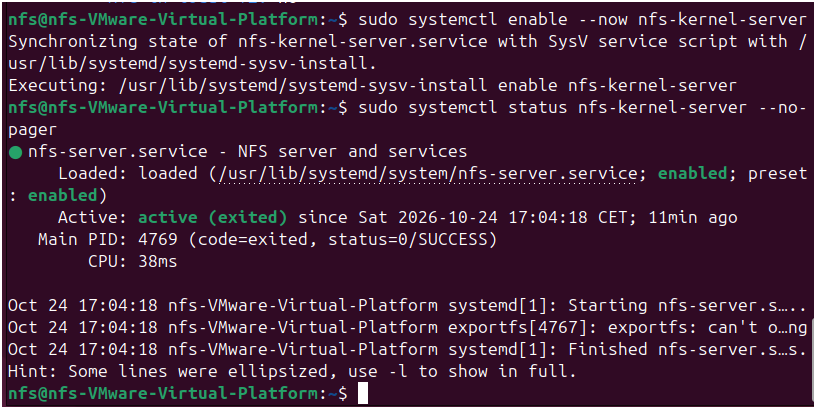
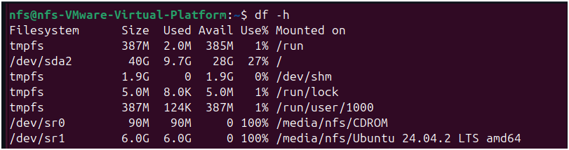
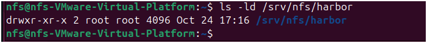
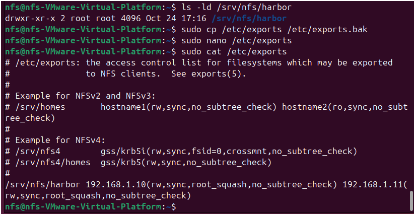
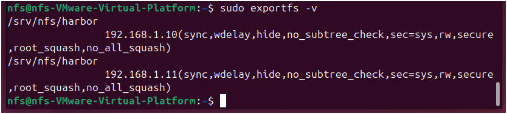
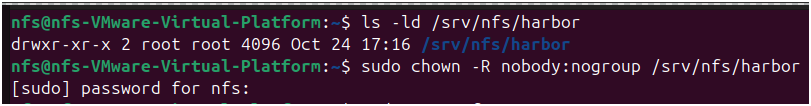
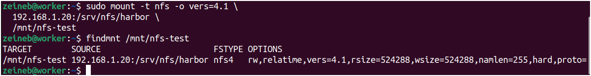
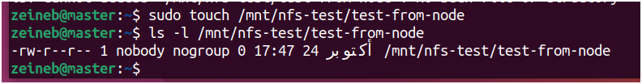
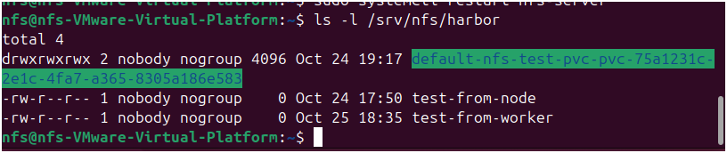

# Step 1 — NFS Server Setup

This document describes how to install and configure an NFS (Network File System) server to provide persistent shared storage for Harbor running on Kubernetes.

The NFS server is configured separately from the Kubernetes cluster. The master and worker nodes are authorized to access the exported directory, which will later be used by the NFS Subdirectory External Provisioner.


## 1. Architecture and Prerequisites

### 1.1 Network architecture

The environment consists of three machines:

| Machine | IP address | Role |
|---|---|---|
| NFS Server | `192.168.1.20` | Provides shared persistent storage |
| Kubernetes Master | `192.168.1.10` | Controls the Kubernetes cluster |
| Kubernetes Worker | `192.168.1.11` | Runs application workloads |

The NFS server exports the following directory:

```text
/srv/nfs/harbor
```

Both Kubernetes nodes will access this directory over the network.

### 1.2 NFS server requirements

Recommended resources for the NFS server:

- 2 vCPUs.
- 2–4 GB of RAM.
- Ubuntu Server with `sudo` privileges.
- A static IP address: `192.168.1.20`.
- Sufficient disk space for Harbor's persistent data.
- Network connectivity between the NFS server and the Kubernetes nodes.

### 1.3 Network requirements

Ensure that the NFS server is reachable from both Kubernetes nodes.

For NFSv4, TCP port `2049` must be permitted between the server and authorized clients.

The NFS export must also restrict access to the intended client addresses.

## 2. Install the NFS Server

**Run all commands in this section on the NFS server (`192.168.1.20`).**

### 2.1 Update the package index

Update the local package index:

```bash
sudo apt update
```

This command refreshes the list of available packages from the configured Ubuntu repositories.


### 2.2 Install the NFS server package

Install the NFS server:

```bash
sudo apt install -y nfs-kernel-server
```

The `nfs-kernel-server` package provides the services required to export directories to remote NFS clients.


### 2.3 Enable and start the service

Enable the NFS service at boot and start it immediately:

```bash
sudo systemctl enable --now nfs-kernel-server
```

- `enable` configures the service to start automatically during system startup.
- `--now` starts the service immediately.


### 2.4 Verify the service status

Check the service status:

```bash
sudo systemctl status nfs-kernel-server --no-pager
```

Confirm that the service is operational. Depending on the Ubuntu version and service implementation, the displayed state may vary; also verify the exported directories in Section 4.



## 3. Create the Shared Directory

### 3.1 Create the Harbor storage directory

Create the directory that will be exported:

```bash
sudo mkdir -p /srv/nfs/harbor
```

The `-p` option creates missing parent directories and does not report an error if the directory already exists.


### 3.2 Check available disk space

Inspect the available storage:

```bash
df -h
```

This command displays filesystem capacity, used space, and available space in a human-readable format.

Ensure that the filesystem hosting `/srv/nfs/harbor` has sufficient capacity for the expected Harbor workload.



### 3.3 Inspect the directory permissions

Check the directory's current owner, group, and permissions:

```bash
ls -ld /srv/nfs/harbor
```

Record the initial permissions before configuring access for the NFS clients.



## 4. Configure the NFS Export

The `/etc/exports` file defines which directories are shared and which client machines can access them.

### 4.1 Back up the export configuration

Create a backup before editing the configuration:

```bash
sudo cp /etc/exports /etc/exports.bak
```

This backup provides a reference for restoring the previous configuration if necessary.


### 4.2 Edit `/etc/exports`

Open the configuration file:

```bash
sudo nano /etc/exports
```

Add the following line:

```text
/srv/nfs/harbor 192.168.1.10(rw,sync,root_squash,no_subtree_check) 192.168.1.11(rw,sync,root_squash,no_subtree_check)
```

Save the file and exit the editor.

This configuration authorizes the Kubernetes master and worker to access the shared directory.

The export options have the following meanings:

| Option | Description |
|---|---|
| `rw` | Allows read and write access, subject to filesystem permissions. |
| `sync` | Acknowledges writes after the server has committed the corresponding changes to stable storage, according to NFS semantics. |
| `root_squash` | Maps requests from the remote root user to an unprivileged identity. |
| `no_subtree_check` | Disables subtree checking for exported directories. |

**Security note:** `rw` does not override Linux filesystem permissions. Both the export configuration and the directory's ownership and permissions must permit the requested operation.



### 4.3 Apply the export configuration

Reload the export configuration:

```bash
sudo exportfs -ra
```

This command re-exports the configured directories without requiring a manual restart of the NFS service.


### 4.4 Verify the active exports

Display the active exports and their options:

```bash
sudo exportfs -v
```

Confirm that `/srv/nfs/harbor` is exported to the intended client addresses with the expected options.



## 5. Configure Directory Permissions

### 5.1 Understand `root_squash`

The `root_squash` option prevents a remote root user from automatically retaining root privileges on the NFS server.

Requests made as root on a client are mapped to an unprivileged identity, commonly `nobody`.

Consequently, using `sudo` on a Kubernetes node does not guarantee that a file can be created on the NFS share.

### 5.2 Check the current directory owner

Run the following command on the NFS server:

```bash
ls -ld /srv/nfs/harbor
```

Inspect the owner, group, and permission bits before making any changes.


### 5.3 Set the directory owner when required

For a dedicated test directory, one possible configuration is to assign ownership to `nobody:nogroup`:

```bash
sudo chown -R nobody:nogroup /srv/nfs/harbor
```

This can permit writes from requests mapped to that identity when the directory permissions allow them.

**Important considerations:**

- Use this command only if the directory is dedicated to this storage configuration.
- The recursive option `-R` also changes the ownership of existing files and subdirectories.
- This is not a universal permission model for Harbor. The appropriate ownership and permissions depend on the identities used by the provisioner and Harbor containers.
- Do not disable `root_squash` or use `chmod 777` simply to work around a permission error.



### 5.4 Verify the updated ownership

Check the resulting directory permissions:

```bash
ls -ld /srv/nfs/harbor
```

Confirm that the displayed owner and group match the intended configuration.


## 6. Configure NFS Clients

**Perform the following steps on both Kubernetes nodes:**

- Master: `192.168.1.10`
- Worker: `192.168.1.11`

### 6.1 Update the package index

```bash
sudo apt update
```


### 6.2 Install the NFS client utilities

```bash
sudo apt install -y nfs-common
```

The `nfs-common` package provides the client utilities needed to mount NFS shares.


### 6.3 Create the mount point

Create a local directory for testing the NFS share:

```bash
sudo mkdir -p /mnt/nfs-test
```

This directory is a temporary test mount point. It is separate from the Kubernetes volumes that will be created later.


### 6.4 Mount the NFS share

On each node, mount the exported directory using NFS version 4.1:

```bash
sudo mount -t nfs -o vers=4.1 \
  192.168.1.20:/srv/nfs/harbor \
  /mnt/nfs-test
```

The command specifies:

- `-t nfs`: the filesystem type.
- `vers=4.1`: the requested NFS protocol version.
- `192.168.1.20:/srv/nfs/harbor`: the server and exported path.
- `/mnt/nfs-test`: the local mount point.

The server must support NFSv4.1, and the export must be accessible to the client.


### 6.5 Verify the mount

Check the mounted filesystem:

```bash
findmnt /mnt/nfs-test
```

Confirm that the output identifies the expected NFS server and exported directory.



Repeat the mount and verification steps on the other Kubernetes node.

## 7. Test NFS Connectivity and Write Access

The following tests verify that both nodes can access the same shared filesystem.

### 7.1 Test writing from the master

On the master node, create a test file:

```bash
sudo touch /mnt/nfs-test/test-from-node
```

If the command fails with `Permission denied`, inspect the directory permissions, the identity mapping applied by `root_squash`, and the export configuration.

Do not change the security settings blindly to force the test to succeed.


### 7.2 Verify the master test file

```bash
ls -l /mnt/nfs-test/test-from-node
```

Confirm that the file exists and inspect its ownership.



### 7.3 Test writing from the worker

On the worker node, create a second test file:

```bash
sudo touch /mnt/nfs-test/test-from-worker
```


### 7.4 Verify the worker test file

```bash
ls -l /mnt/nfs-test/test-from-worker
```


### 7.5 Verify both files on the NFS server

Return to the NFS server and list the shared directory:

```bash
ls -l /srv/nfs/harbor
```

Both `test-from-node` and `test-from-worker` should be visible.

This confirms that the two Kubernetes nodes are accessing the same shared directory on the NFS server.



### 7.6 Acceptance criteria

The NFS configuration can be considered validated when:

- The NFS service is operational.
- The intended directory is exported to both Kubernetes nodes.
- Both nodes can mount the share.
- Both nodes can perform the required write operations.
- Files created by either node are visible from the NFS server.

Successful node-level tests do not, by themselves, guarantee that Harbor's containers will have the correct filesystem permissions. That must also be validated when Kubernetes persistent volumes are tested.

## 8. Troubleshooting

### 8.1 The NFS service is not running

Check the service status:

```bash
sudo systemctl status nfs-kernel-server --no-pager
```

Review recent service logs:

```bash
sudo journalctl -u nfs-kernel-server -n 100 --no-pager
```

### 8.2 The export is missing or incorrect

Display the active exports:

```bash
sudo exportfs -v
```

Check the configuration file:

```bash
sudo cat /etc/exports
```

After correcting the configuration, reload the exports:

```bash
sudo exportfs -ra
```

### 8.3 The client cannot mount the share

On the client, inspect network connectivity:

```bash
ping -c 4 192.168.1.20
```

Check whether the NFS server is listening on TCP port 2049:

```bash
sudo ss -lnt | grep ':2049'
```

The ping test may fail if ICMP traffic is blocked, even when NFS connectivity is available. Verify the firewall rules and NFS service configuration independently.

### 8.4 The client receives `Permission denied`

On the NFS server, inspect:

```bash
ls -ld /srv/nfs/harbor
sudo exportfs -v
```

Check the effective UID/GID and the filesystem permissions of the relevant directory. Remember that `root_squash` maps remote root requests to an unprivileged identity.

### 8.5 The NFS share is already mounted

Inspect the current mount:

```bash
findmnt /mnt/nfs-test
```

If necessary, unmount the test share before mounting it again:

```bash
sudo umount /mnt/nfs-test
```

Only unmount the directory when no active workload depends on that mount.

## 9. Completion Criteria

After completing this guide, the environment should have:

- A configured NFS server at `192.168.1.20`.
- An exported directory at `/srv/nfs/harbor`.
- Restricted access for the master and worker nodes.
- NFS client utilities installed on both Kubernetes nodes.
- A successful mount and write test from each node.

The next step is to configure Kubernetes persistent storage using the NFS Subdirectory External Provisioner and a dedicated StorageClass.

**Next document:** [Kubernetes Persistent Storage](02-kubernetes-storage.md)

