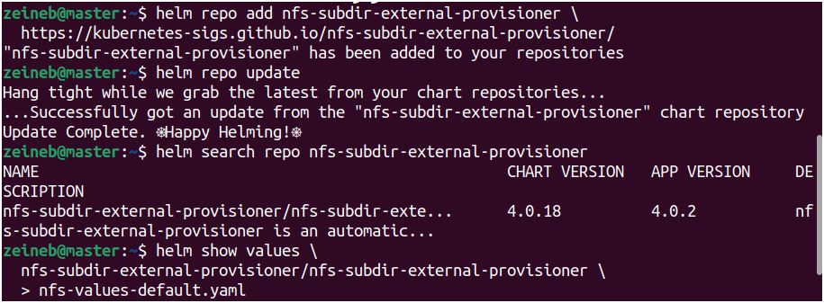
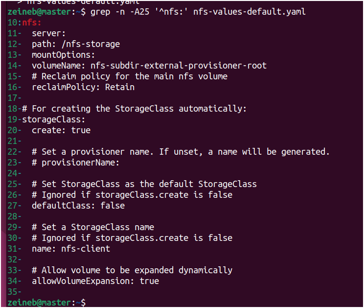
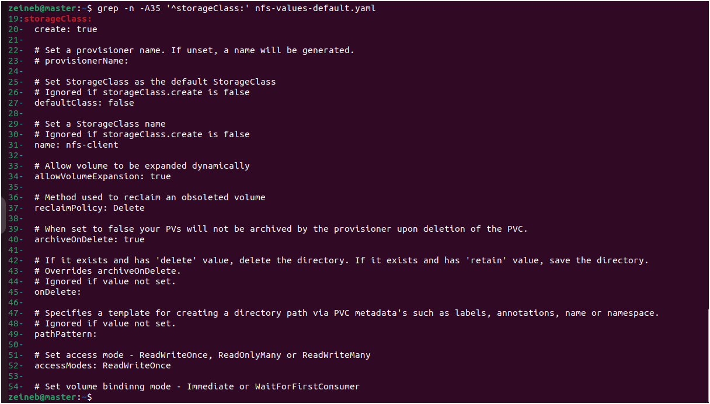
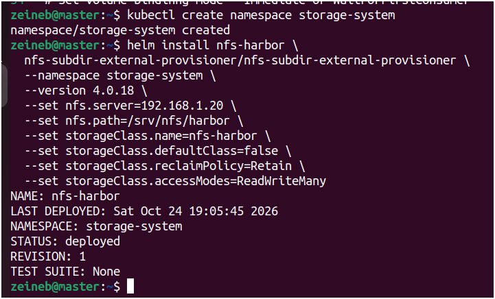
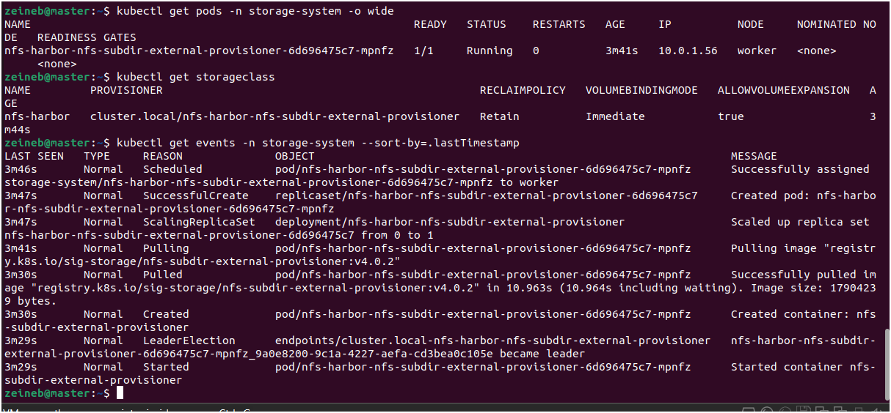
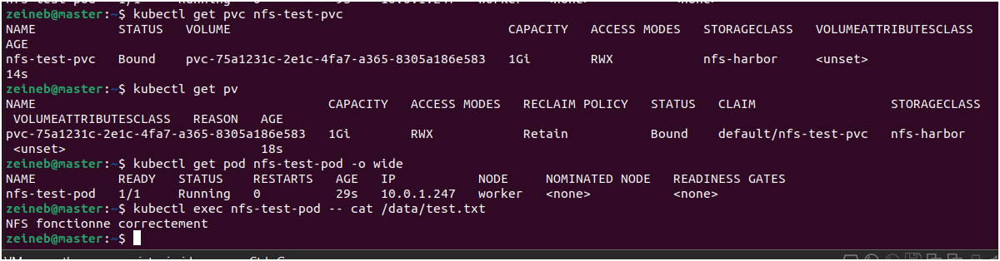
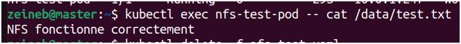
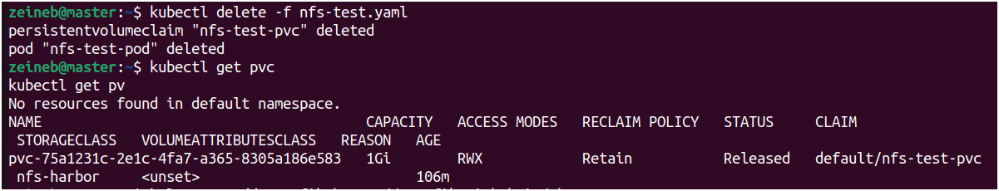

# 02 — Kubernetes Storage with NFS and Helm

This guide explains how to deploy the NFS Subdirectory External Provisioner on a Kubernetes cluster using Helm. It covers dynamic PersistentVolume provisioning, StorageClass configuration, PVC validation, troubleshooting, and storage preparation for Harbor.

## 1. Architecture and Prerequisites

The NFS server provides shared storage for the Kubernetes cluster. The NFS Subdirectory External Provisioner automatically creates subdirectories inside the exported NFS directory when PersistentVolumeClaims request storage through the configured StorageClass.

| Component | Configuration |
|---|---|
| Kubernetes master | `192.168.1.10` |
| Kubernetes worker | `192.168.1.11` |
| NFS server | `192.168.1.20` |
| NFS export path | `/srv/nfs/harbor` |
| Provisioner namespace | `storage-system` |
| StorageClass | `nfs-harbor` |
| Access mode | `ReadWriteMany` |

Before proceeding, ensure that:

- The NFS server is configured and accessible from both Kubernetes nodes.
- Write tests from the master and worker have succeeded.
- `kubectl` is configured to access the cluster.
- Helm is installed on the master node.

## 2. Add the Helm Repository

### 2.1. Add the official repository

Run the following command on the Kubernetes master:

```bash
helm repo add nfs-subdir-external-provisioner \
  https://kubernetes-sigs.github.io/nfs-subdir-external-provisioner/
```


### 2.2. Update the repository index

```bash
helm repo update
```


### 2.3. Verify chart availability

```bash
helm search repo nfs-subdir-external-provisioner
```


### 2.4. List available chart versions

```bash
helm search repo nfs-subdir-external-provisioner --versions
```


Choose a version displayed by this command. Record the exact version because it will be used in the following steps.

## 3. Inspect the Chart Configuration

### 3.1. Download the default values

Replace `VERSION` with the chart version selected in Section 2.

```bash
helm show values \
  nfs-subdir-external-provisioner/nfs-subdir-external-provisioner \
  --version VERSION \
  > nfs-values-default.yaml
```



### 3.2. Inspect the NFS configuration

```bash
grep -n -A25 '^nfs:' nfs-values-default.yaml
```



### 3.3. Inspect the StorageClass configuration

```bash
grep -n -A35 '^storageClass:' nfs-values-default.yaml
```



These commands help identify the configuration keys supported by the selected chart version. Verify the options before installation instead of assuming that every chart version uses the same values.

## 4. Create the Namespace

### 4.1. Create the provisioner namespace

```bash
kubectl create namespace storage-system
```


If Kubernetes reports that the namespace already exists, continue with the verification step below.

### 4.2. Verify the namespace

```bash
kubectl get namespace storage-system
```


The namespace should have the `Active` status.

## 5. Install the NFS Provisioner

The NFS Subdirectory External Provisioner dynamically provisions PersistentVolumes by creating subdirectories inside the configured NFS export.

### 5.1. Define the chart version

Replace `VERSION` with the exact version verified in Section 2.

```bash
CHART_VERSION="VERSION"
```


### 5.2. Install the provisioner

The following command configures the NFS server, export path, StorageClass name, reclaim policy, and access mode.

```bash
helm install nfs-harbor \
  nfs-subdir-external-provisioner/nfs-subdir-external-provisioner \
  --namespace storage-system \
  --version "$CHART_VERSION" \
  --set nfs.server=192.168.1.20 \
  --set nfs.path=/srv/nfs/harbor \
  --set storageClass.name=nfs-harbor \
  --set storageClass.defaultClass=false \
  --set storageClass.reclaimPolicy=Retain \
  --set 'storageClass.accessModes[0]=ReadWriteMany'
```



**Important:** Confirm that the chart version supports all the specified options. If the release already exists, inspect it with `helm list -n storage-system` before deciding whether to install or upgrade it.

The `Retain` reclaim policy helps prevent automatic reclamation of the underlying PersistentVolume when its claim is deleted. It does not replace backups.

## 6. Verify the Installation

### 6.1. Check the Helm release

```bash
helm list -n storage-system
```


### 6.2. Check the provisioner pods

```bash
kubectl get pods -n storage-system -o wide
```


The provisioner pod should become `Running` and ready.

### 6.3. Check the Deployment

```bash
kubectl get deployments -n storage-system
```


### 6.4. Check the StorageClass

```bash
kubectl get storageclass
```


The `nfs-harbor` StorageClass should appear in the output.

### 6.5. Inspect the StorageClass details

```bash
kubectl describe storageclass nfs-harbor
```


Verify the provisioner, reclaim policy, and other relevant settings.

### 6.6. Inspect recent events

```bash
kubectl get events -n storage-system \
  --sort-by=.lastTimestamp
```



Events can help identify image-pulling problems, scheduling errors, or other deployment issues.

### 6.7. Identify the Deployment name

If the provisioner pod fails, first retrieve the actual Deployment name:

```bash
kubectl get deployments -n storage-system
```


### 6.8. Retrieve the provisioner logs

Replace `DEPLOYMENT_NAME` with the actual Deployment name returned by the previous command.

```bash
kubectl logs -n storage-system deployment/DEPLOYMENT_NAME
```


Do not continue to the PVC test until the provisioner is operational and the StorageClass exists.

## 7. Test Dynamic PersistentVolume Provisioning

A running provisioner does not necessarily mean that it can successfully create and mount volumes. This test validates the complete provisioning workflow.

### 7.1. Create the test manifest

On the Kubernetes master, create the file:

```bash
nano nfs-test.yaml
```


Add the following YAML configuration to the file:

```yaml
apiVersion: v1
kind: PersistentVolumeClaim
metadata:
  name: nfs-test-pvc
  namespace: default
spec:
  accessModes:
    - ReadWriteMany
  storageClassName: nfs-harbor
  resources:
    requests:
      storage: 1Gi
---
apiVersion: v1
kind: Pod
metadata:
  name: nfs-test-pod
  namespace: default
spec:
  containers:
    - name: test
      image: busybox:1.36
      command:
        - sh
        - -c
        - "echo 'NFS fonctionne' > /data/test.txt && sleep 3600"
      volumeMounts:
        - name: nfs-volume
          mountPath: /data
  volumes:
    - name: nfs-volume
      persistentVolumeClaim:
        claimName: nfs-test-pvc
```

This manifest creates a PersistentVolumeClaim requesting `1Gi` and a Pod that mounts the claim at `/data` and writes a test file.

Save the file and exit the editor.

### 7.2. Apply the manifest

```bash
kubectl apply -f nfs-test.yaml
```


### 7.3. Check the PersistentVolumeClaim

```bash
kubectl get pvc nfs-test-pvc
```


The PVC should eventually reach the `Bound` state.

### 7.4. Check the PersistentVolumes

```bash
kubectl get pv
```


Verify that the volume associated with `nfs-test-pvc` exists and is bound.

### 7.5. Check the test Pod

```bash
kubectl get pod nfs-test-pod -o wide
```



The Pod should reach the `Running` state.

### 7.6. Check the Pod logs

```bash
kubectl logs nfs-test-pod
```


### 7.7. Read the test file

```bash
kubectl exec nfs-test-pod -- cat /data/test.txt
```



Expected output:

```text
NFS fonctionne
```

This confirms that the test Pod can write to and read from the mounted volume.

### 7.8. Verify the file on the NFS server

Run this command on the NFS server, not on the Kubernetes master unless they are the same machine:

```bash
sudo find /srv/nfs/harbor -type f -name test.txt
```


The exact directory depends on the subdirectory created by the provisioner.

**Storage capacity note:** The `1Gi` request does not enforce a strict physical quota on the NFS share. Monitor the actual free disk space on the NFS server.

## 8. Troubleshooting the PVC Test

### 8.1. Inspect a PVC that remains Pending

```bash
kubectl describe pvc nfs-test-pvc
```


### 8.2. Inspect recent cluster events

```bash
kubectl get events --sort-by=.lastTimestamp
```


### 8.3. Inspect the test Pod

```bash
kubectl describe pod nfs-test-pod
```


### 8.4. Retrieve the test Pod logs

```bash
kubectl logs nfs-test-pod
```


If the PVC or Pod fails, verify:

- The NFS server address and export path.
- Network connectivity between the Kubernetes nodes and the NFS server.
- NFS directory permissions.
- Provisioner pod status and logs.
- The StorageClass name and configuration.

## 9. Clean Up the Test Resources

Only perform this cleanup after completing the test and confirming that the data is no longer needed.

### 9.1. Delete the test Pod

```bash
kubectl delete pod nfs-test-pod
```


### 9.2. Delete the test PVC

```bash
kubectl delete pvc nfs-test-pvc
```



Because the StorageClass uses the `Retain` reclaim policy, the PersistentVolume may remain in the `Released` state after its claim is deleted. This is expected.

Do not manually delete the PersistentVolume or remove its NFS directory until you have confirmed that it contains only disposable test data.

## 10. Prepare Storage for Harbor

Once the PVC test succeeds, the NFS provisioner is ready for the next stage of the deployment.


## References

- [NFS Subdirectory External Provisioner — Official GitHub Repository](https://github.com/kubernetes-sigs/nfs-subdir-external-provisioner)
- [NFS Subdirectory External Provisioner — Helm Chart Repository](https://kubernetes-sigs.github.io/nfs-subdir-external-provisioner/)
- [Kubernetes PersistentVolumes](https://kubernetes.io/docs/concepts/storage/persistent-volumes/)
- [Kubernetes StorageClasses](https://kubernetes.io/docs/concepts/storage/storage-classes/)
- [Harbor Documentation](https://goharbor.io/docs/)
