# 03 — Traefik and MetalLB Installation on Kubernetes

This guide explains how to expose applications running in a local Kubernetes cluster using Traefik as an Ingress Controller and MetalLB as a software load balancer.

Traefik handles HTTP and HTTPS routing, while MetalLB assigns external IP addresses to Kubernetes Services of type `LoadBalancer`. This setup prepares the cluster for the Harbor deployment.

## 1. Architecture Overview

### Network configuration

| Component | IP address |
|---|---|
| Kubernetes master | `192.168.1.10` |
| Kubernetes worker | `192.168.1.11` |
| NFS server | `192.168.1.20` |
| Windows client | `192.168.1.224` |
| Network gateway | `192.168.1.1` |
| Local network | `192.168.1.0/24` |

The request flow is as follows:

1. The client sends a request to the IP address assigned to Traefik by MetalLB.
2. MetalLB announces the IP address on the local network.
3. Traefik receives the HTTP or HTTPS request.
4. Traefik identifies the matching Ingress rule using the requested hostname.
5. The request is forwarded to the appropriate Kubernetes Service and application Pods.

**Note:** MetalLB provides the external IP address. Traefik performs the HTTP/HTTPS routing. TLS termination and Harbor-specific routing will be configured in subsequent steps.

## 2. Prerequisites

### 2.1. Check the Kubernetes nodes

Run this command on the master:

```bash
kubectl get nodes -o wide
```

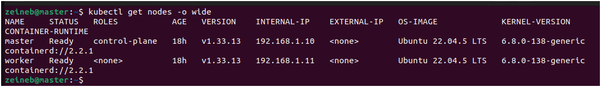

Both the master and worker should be `Ready`.

### 2.2. Check the cluster Pods

```bash
kubectl get pods -A
```

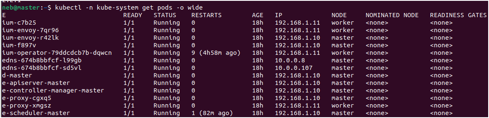

Review the output and investigate any critical Pods that are not running as expected.


## 3. Install Traefik with Helm

Traefik will act as the Ingress Controller for applications deployed in the cluster. Its Service will use the `LoadBalancer` type so that MetalLB can assign an external IP address.

### 3.1. Add the official Helm repository

```bash
helm repo add traefik https://traefik.github.io/charts
```

### 3.2. Update the Helm repositories

```bash
helm repo update
```


### 3.3. Search for the Traefik chart

```bash
helm search repo traefik/traefik
```
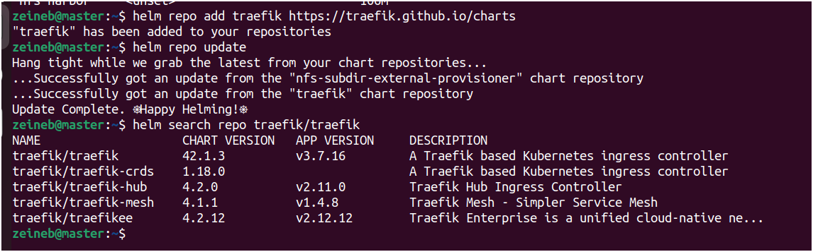

Record the chart version shown in the output if you want to pin the version for a reproducible installation.

### 3.4. Inspect the chart configuration

Download the default values:

```bash
helm show values traefik/traefik > traefik-values-default.yaml
```

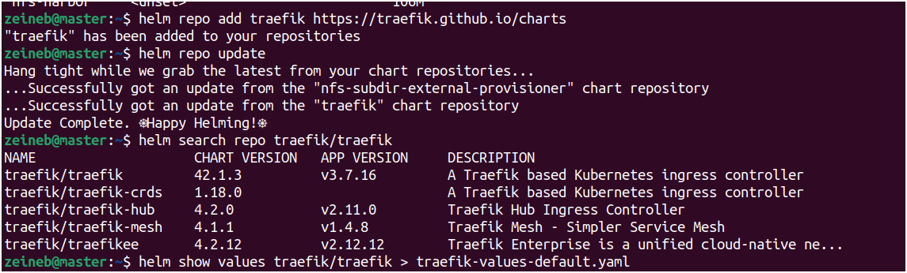


Inspect the Service configuration:

```bash
grep -n -A25 '^service:' traefik-values-default.yaml
```

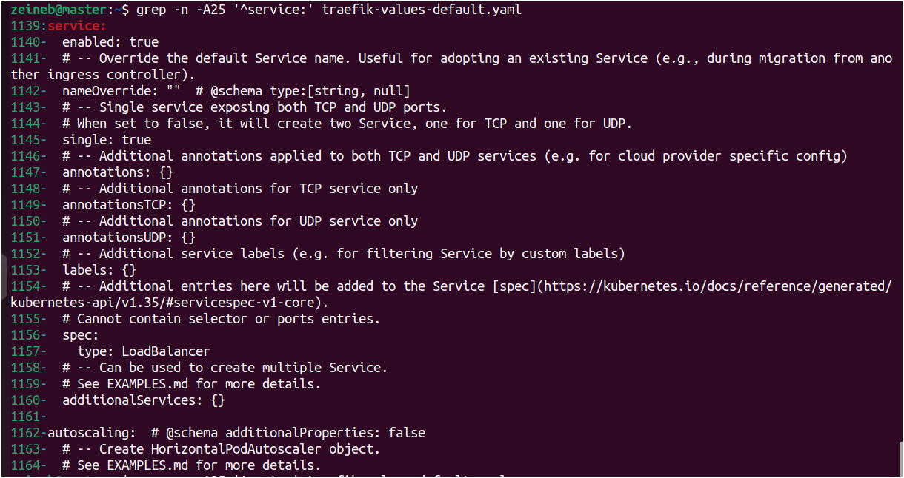

Inspect the entrypoint and port configuration:

```bash
grep -n -A35 '^ports:' traefik-values-default.yaml
```

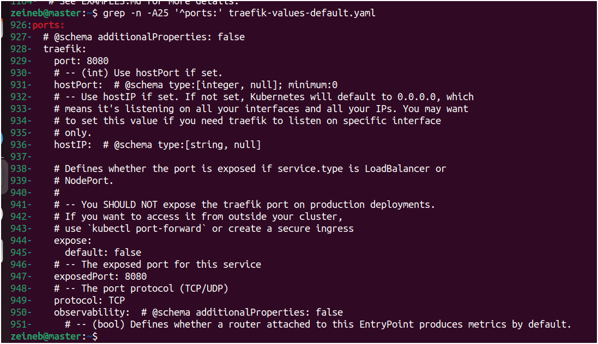

The exact configuration keys can vary by chart version. Verify the values supported by the selected version before installation.

### 3.5. Create the Traefik namespace

```bash
kubectl create namespace traefik
```


If the namespace already exists, do not recreate it. Verify it instead:

```bash
kubectl get namespace traefik
```


### 3.6. Install Traefik

Install Traefik with a `LoadBalancer` Service:

```bash
helm upgrade --install traefik traefik/traefik \
  --namespace traefik \
  --set service.type=LoadBalancer \
  --wait \
  --timeout 5m
```

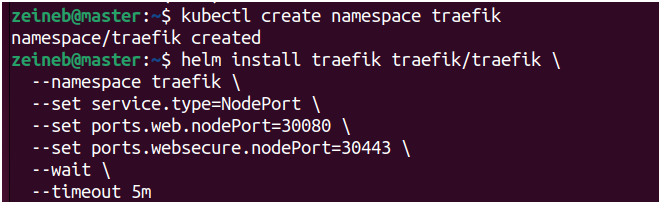

The `upgrade --install` command installs the release if it does not exist or upgrades it if it already exists.

Before MetalLB is configured, the external IP address may remain `Pending`. This is expected in a local cluster without another load balancer implementation.

### 3.7. Verify the Traefik Pods

```bash
kubectl get pods -n traefik -o wide
```

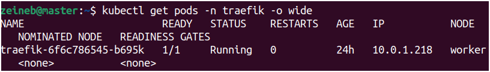

The Traefik Pod should become `Running` and ready.

### 3.8. Verify the Traefik Service

```bash
kubectl get svc -n traefik
```

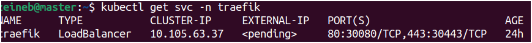

Before MetalLB is configured, the `EXTERNAL-IP` field may display `Pending`.

Depending on the chart configuration, the Service may also expose NodePorts such as `30080` for HTTP and `30443` for HTTPS. Verify the actual ports in the command output rather than assuming they are fixed.

### 3.9. Check the IngressClass

```bash
kubectl get ingressclass
```
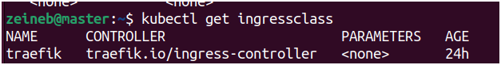

The expected IngressClass is `traefik`, provided that IngressClass creation is enabled in the chart configuration.

Verify it directly:

```bash
kubectl get ingressclass traefik
```


### 3.10. Test HTTP access through a NodePort

If the Service exposes HTTP on NodePort `30080`, test access through the master node:

```bash
curl -I http://192.168.1.10:30080
```

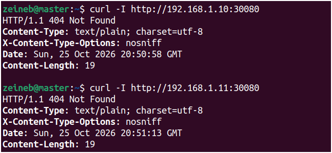

A `404 Not Found` response can be normal because no Ingress route has been created yet. It can indicate that Traefik received the request but did not find a matching route.

This test is applicable only if NodePort `30080` is actually exposed by the Service. Use the actual NodePort shown by `kubectl get svc -n traefik` if it differs.

## 4. Install MetalLB

MetalLB enables Kubernetes `LoadBalancer` Services to receive external IP addresses in local or bare-metal environments that do not have a cloud-provider load balancer.

This guide uses MetalLB Layer 2 mode, which announces IPv4 addresses on the local network using ARP.

### 4.1. Add the official MetalLB Helm repository

```bash
helm repo add metallb https://metallb.github.io/metallb
```


### 4.2. Update the Helm repositories

```bash
helm repo update
```


### 4.3. Create the MetalLB namespace

```bash
kubectl create namespace metallb-system
```
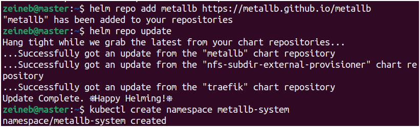


If the namespace already exists, verify it rather than creating it again:

```bash
kubectl get namespace metallb-system
```

### 4.4. Configure namespace security labels

MetalLB's networking components may require elevated permissions. For clusters enforcing Kubernetes Pod Security Admission, the namespace may need the `privileged` enforcement level.

Apply the labels:

```bash
kubectl label namespace metallb-system \
  pod-security.kubernetes.io/enforce=privileged \
  pod-security.kubernetes.io/audit=privileged \
  pod-security.kubernetes.io/warn=privileged \
  --overwrite
```


These labels configure Pod Security Admission for this namespace. Apply them only when appropriate for your environment and security requirements.

### 4.5. Install MetalLB

```bash
helm upgrade --install metallb metallb/metallb \
  --namespace metallb-system
```
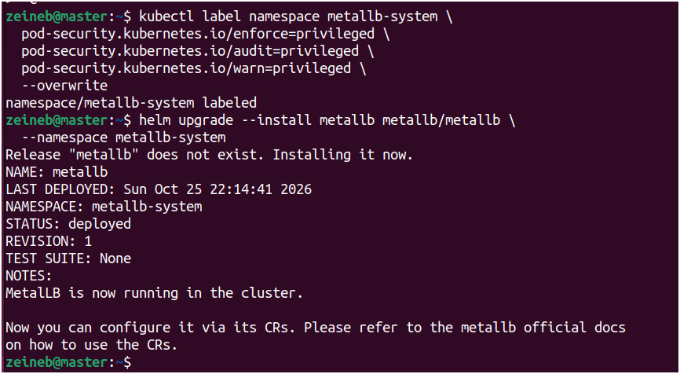


This command installs MetalLB or upgrades an existing release. The exact set of components depends on the chart version and configuration.

### 4.6. Check the MetalLB Pods

```bash
kubectl get pods -n metallb-system -o wide
```

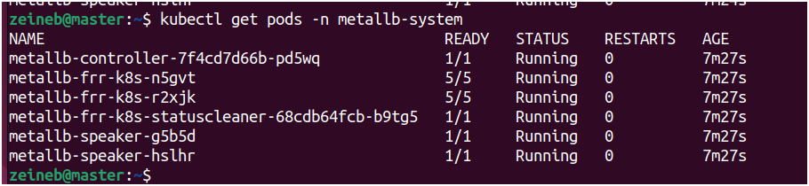

Wait for the required MetalLB components to become ready.

### 4.7. Check the MetalLB Custom Resource Definitions

```bash
kubectl get crd | grep metallb
```


The Custom Resource Definitions (CRDs) must be available before applying the IP address pool and Layer 2 advertisement resources.

## 5. Configure the MetalLB IP Address Pool

MetalLB can allocate addresses only from a configured address pool.

The local network in this example is `192.168.1.0/24`. A candidate range is `192.168.1.240-192.168.1.250`.

**Important:** This range is only an example. Before using it, verify that the addresses are unused, belong to the correct network, and do not conflict with the router's DHCP pool or other devices.

### 5.1. Create the configuration file

Create the file:

```bash
nano metallb-config.yaml
```


Add the following configuration, replacing the example address range if necessary:

```yaml
apiVersion: metallb.io/v1beta1
kind: IPAddressPool
metadata:
  name: local-pool
  namespace: metallb-system
spec:
  addresses:
    - 192.168.1.240-192.168.1.250
---
apiVersion: metallb.io/v1beta1
kind: L2Advertisement
metadata:
  name: local-l2
  namespace: metallb-system
spec:
  ipAddressPools:
    - local-pool
```

Save the file and exit the editor.

The `IPAddressPool` resource defines the IP addresses MetalLB can allocate. The `L2Advertisement` resource enables the pool's addresses to be announced on the local network.

### 5.2. Apply the configuration

```bash
kubectl apply -f metallb-config.yaml
```


### 5.3. Verify the IP address pool

```bash
kubectl get ipaddresspools -n metallb-system
```


### 5.4. Verify the Layer 2 advertisement

```bash
kubectl get l2advertisements -n metallb-system
```
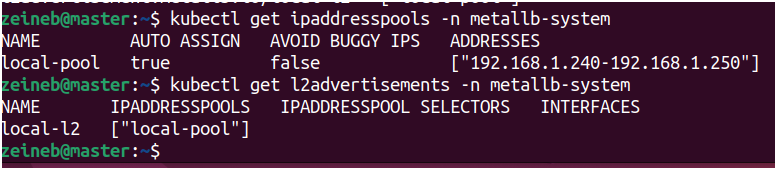

If your nodes have multiple network interfaces, verify which interface MetalLB uses to announce the addresses. The `interfaces` field can be configured in `L2Advertisement` when necessary, using the actual interface names from your nodes.

## 6. Verify External IP Assignment to Traefik

After MetalLB is installed and configured, check whether it assigns an external IP address to the Traefik Service.

### 6.1. Watch the Traefik Service

```bash
kubectl get svc traefik -n traefik -w
```


Wait until the `EXTERNAL-IP` field contains an address from the configured pool. Stop watching with `Ctrl+C` once the address has been assigned.

Example output (illustrative only):

```text
NAME      TYPE           CLUSTER-IP     EXTERNAL-IP      PORT(S)
traefik   LoadBalancer   10.x.x.x       192.168.1.240   ...
```

The actual IP address and ports depend on your cluster and configuration.

### 6.2. Verify the Traefik Service

```bash
kubectl get svc traefik -n traefik
```

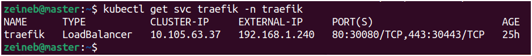

### 6.3. Inspect the Service details

```bash
kubectl describe svc traefik -n traefik
```


Verify the Service type, ports, endpoints, and any events indicating address allocation problems.

### 6.4. Troubleshoot a Pending external IP

If the external IP remains `Pending`, inspect recent events in the Traefik namespace:

```bash
kubectl get events -n traefik --sort-by=.lastTimestamp
```


Check the MetalLB Pods and identify the controller:

```bash
kubectl get pods -n metallb-system --show-labels
```


Use the actual controller Pod name returned by the previous command to inspect its logs:

```bash
kubectl logs -n metallb-system CONTROLLER_POD_NAME --tail=100
```


Replace `CONTROLLER_POD_NAME` with the actual Pod name. If the controller has multiple containers, specify the appropriate container using `-c CONTAINER_NAME`.

Check that the IP pool and Layer 2 advertisement exist and that the addresses are available on the local network.

## 7. Test Access from the Local Network

Once MetalLB has assigned an external IP to Traefik, test access from the Windows client.

### 7.1. Open the Traefik external IP in a browser

In the Windows browser, enter:

```text
http://IP_EXTERNE_TRAEFIK
```

Replace `IP_EXTERNE_TRAEFIK` with the actual external IP assigned to the Traefik Service.


A `404 Not Found` response may be expected before an Ingress route has been configured.

### 7.2. Test HTTP connectivity from Windows

Open PowerShell and execute:

```powershell
curl.exe -I http://IP_EXTERNE_TRAEFIK
```


Replace the placeholder with the actual IP address.

This test confirms that the client can reach Traefik. It does not yet verify routing to Harbor, which will be configured in a later stage.

If the connection fails, verify network routing, firewall rules, MetalLB address announcements, and the Traefik Service configuration.

## 8. Next Steps: Harbor DNS, TLS, and Ingress

The next stage is to configure the local hostname `harbor.k8s.local`, prepare the TLS certificate, create the Harbor Ingress resources, and deploy Harbor with the `nfs-harbor` StorageClass.

## 9. Official References

- [Traefik Kubernetes Documentation](https://doc.traefik.io/traefik/setup/kubernetes/)
- [Official Traefik Helm Chart](https://github.com/traefik/traefik-helm-chart)
- [MetalLB Installation Documentation](https://metallb.io/installation/)
- [MetalLB Configuration Documentation](https://metallb.io/configuration/)
- [Kubernetes Services](https://kubernetes.io/docs/concepts/services-networking/service/)
- [Kubernetes Ingress](https://kubernetes.io/docs/concepts/services-networking/ingress/)
