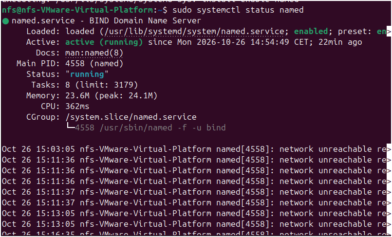
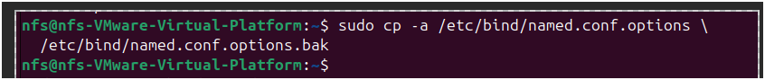
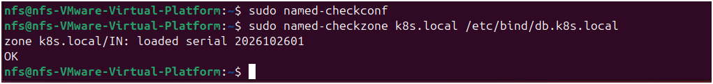
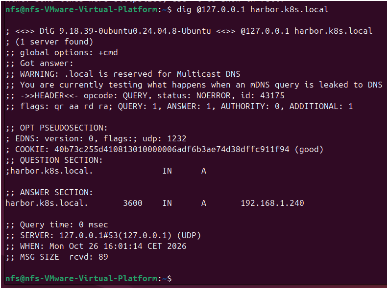
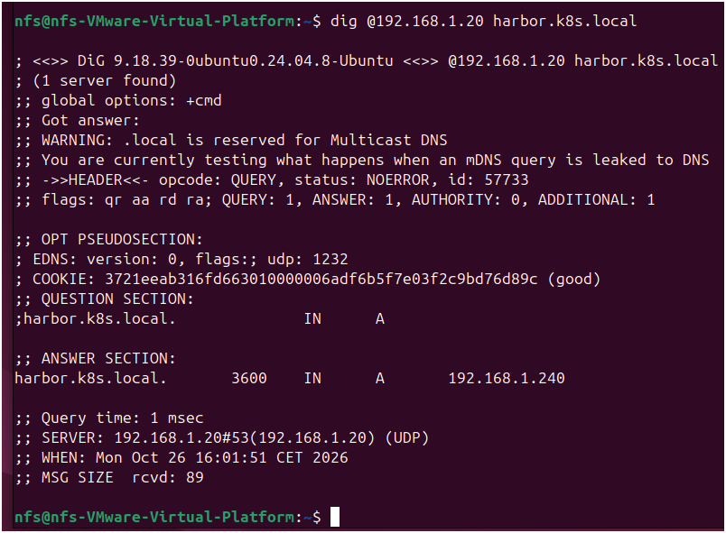

# Configure a Local DNS Server with BIND9 for Harbor on Kubernetes

## Overview

This guide explains how to configure a local DNS server using BIND9 to access Harbor through the hostname `harbor.k8s.local` in a Kubernetes cluster.

The DNS server resolves the Harbor hostname to the external IP address assigned to Traefik by MetalLB. This allows clients on the local network to access Harbor using HTTPS without manually configuring a hosts file on every client.

## 1. Lab Environment

| Component | Example value |
|---|---|
| DNS server | `192.168.1.20` |
| Local network | `192.168.1.0/24` |
| Harbor hostname | `harbor.k8s.local` |
| Traefik external IP | `192.168.1.240` |
| DNS server interface | `ens33` |
| Example Windows client | `192.168.1.224` |

**Important:** These are example values. Verify the actual IP address assigned to Traefik and the network configuration of your DNS server before applying the configuration.

## 2. Identify the Traefik External IP

Run the following command on a machine with access to the Kubernetes cluster:

```bash
kubectl get svc -n traefik
```

Identify the Traefik Service and note its `EXTERNAL-IP`. This is the address that the DNS record for Harbor must resolve to.


If the external IP is shown as `<pending>`, check the MetalLB configuration and IP address pool before continuing.

## 3. Check the DNS Server Network Configuration

On the Ubuntu machine that will host BIND9, run:

```bash
ip -br address
ip route
nmcli connection show
```


Confirm the DNS server's LAN address and identify the correct network interface and NetworkManager connection name.

In the following examples, the DNS server address is `192.168.1.20`. Replace it if your environment uses another address.

## 4. Install BIND9

Update the package index:

```bash
sudo apt update
```


Install BIND9 and the DNS diagnostic utilities:

```bash
sudo apt install -y bind9 bind9-utils dnsutils
```


Check the BIND9 service status:

```bash
systemctl status named --no-pager
```



If your system does not recognize the `named` service, try:

```bash
systemctl status bind9 --no-pager
```

Use the service name that exists on your system in the following steps.

## 5. Configure BIND9 Options

Back up the original configuration file:

```bash
sudo cp /etc/bind/named.conf.options /etc/bind/named.conf.options.bak
```



Open the configuration file:

```bash
sudo nano /etc/bind/named.conf.options
```


Configure BIND9 as follows. Adjust the server IP address and trusted subnet if your environment differs.

```conf
acl "trusted" {
    127.0.0.1;
    192.168.1.0/24;
};

options {
    directory "/var/cache/bind";

    listen-on {
        127.0.0.1;
        192.168.1.20;
    };

    listen-on-v6 { none; };

    recursion yes;
    allow-query { trusted; };
    allow-recursion { trusted; };

    forwarders {
        1.1.1.1;
        8.8.8.8;
    };

    forward only;
    dnssec-validation auto;
};
```


**Security note:** The ACL allows DNS queries only from localhost and the specified local subnet. Do not expose a recursive DNS resolver to untrusted networks.

## 6. Declare the DNS Zone

Back up the local configuration file:

```bash
sudo cp /etc/bind/named.conf.local /etc/bind/named.conf.local.bak
```


Edit the file:

```bash
sudo nano /etc/bind/named.conf.local
```


Add the following zone declaration:

```conf
zone "k8s.local" {
    type primary;
    file "/etc/bind/db.k8s.local";
    allow-query { trusted; };
    allow-update { none; };
};
```


This configuration declares `k8s.local` as a primary DNS zone and specifies the file that contains its records.

## 7. Create the DNS Zone File

Create the zone file:

```bash
sudo nano /etc/bind/db.k8s.local
```


Add the following records:

```dns
$TTL 86400
@   IN  SOA ns.k8s.local. admin.k8s.local. (
        2026102601 ; Serial
        3600       ; Refresh
        1800       ; Retry
        604800     ; Expire
        86400      ; Negative Cache TTL
)

@       IN  NS  ns.k8s.local.
ns      IN  A   192.168.1.20
harbor  IN  A   192.168.1.240
```


**Important:** Replace `192.168.1.240` with the actual Traefik external IP obtained in Step 2. If you change the zone later, increment the SOA serial number.

Set the ownership and permissions:

```bash
sudo chown root:bind /etc/bind/db.k8s.local
sudo chmod 644 /etc/bind/db.k8s.local
```


**Note about `.local`:** The `.local` suffix is reserved for Multicast DNS (mDNS), which can cause inconsistent behavior on some clients. For a new deployment, consider using a subdomain of a domain you own or `home.arpa` for a home network. If you change the suffix, update the zone declaration, DNS records, client hostname, and TLS certificate consistently.

## 8. Validate the BIND9 Configuration

Validate the main configuration:

```bash
sudo named-checkconf
```

No output normally indicates that the configuration syntax is valid.

Validate the DNS zone:

```bash
sudo named-checkzone k8s.local /etc/bind/db.k8s.local
```



The command should report that the zone loaded successfully and end with `OK`.

If either command reports an error, correct the configuration before restarting the service.

## 9. Restart and Verify BIND9

If the service is named `named`, restart it and check its status:

```bash
sudo systemctl restart named
sudo systemctl status named --no-pager
```


If your system uses the `bind9` service unit instead, run:

```bash
sudo systemctl restart bind9
sudo systemctl status bind9 --no-pager
```

If the service fails to start, inspect the logs:

```bash
sudo journalctl -u named -n 50 --no-pager
```


For a `bind9` service unit, replace `named` with `bind9` in the log command.

## 10. Test DNS Resolution on the DNS Server

Test the DNS service through the loopback address:

```bash
dig @127.0.0.1 harbor.k8s.local
```



Test the DNS service through its LAN address:

```bash
dig @192.168.1.20 harbor.k8s.local
```



The answer should contain the current external IP address of Traefik.

If the returned address is incorrect, verify the `harbor` A record in `/etc/bind/db.k8s.local`, increment the zone serial if you edited the file, and reload or restart BIND9.

## 11. Configure Firewall Rules (If UFW Is Enabled)

Check the firewall status:

```bash
sudo ufw status verbose
```


If UFW is active, allow DNS queries from the local network over UDP and TCP port 53:

```bash
sudo ufw allow from 192.168.1.0/24 to 192.168.1.20 port 53 proto udp
sudo ufw allow from 192.168.1.0/24 to 192.168.1.20 port 53 proto tcp
sudo ufw status numbered
```


Do not enable UFW without reviewing existing rules, especially SSH, NFS, and Kubernetes-related requirements. If you use a different firewall, configure equivalent rules there.

## 12. Configure DNS on a Linux Client

On a Linux client using `systemd-resolved`, inspect its DNS configuration and network interfaces:

```bash
resolvectl status
ip -br address
```


For a temporary configuration, replace `ens33` with the correct client interface:

```bash
sudo resolvectl dns ens33 192.168.1.20
sudo resolvectl domain ens33 '~k8s.local'
sudo resolvectl flush-caches
```


Test the hostname:

```bash
resolvectl query harbor.k8s.local
```


These settings may not persist after a reboot or network reconnection.

For a persistent NetworkManager configuration, first identify the correct connection name:

```bash
nmcli connection show
```


Replace `netplan-ens33` below with the actual connection name:

```bash
sudo nmcli connection modify "netplan-ens33" ipv4.dns "192.168.1.20"
sudo nmcli connection modify "netplan-ens33" ipv4.dns-search "~k8s.local"
sudo nmcli connection modify "netplan-ens33" ipv4.ignore-auto-dns yes
```


Apply the changes:

```bash
sudo nmcli device reapply ens33
```


Use the correct interface name. Applying network changes may interrupt connectivity, so perform this step from a local console or ensure you have another way to recover access.

## References

- [BIND 9 Documentation](https://bind9.readthedocs.io/)
- [Ubuntu Server Documentation](https://documentation.ubuntu.com/server/)
- [systemd-resolved Manual](https://www.freedesktop.org/software/systemd/man/latest/resolvectl.html)
- [NetworkManager Documentation](https://networkmanager.dev/docs/)
- [MetalLB Documentation](https://metallb.universe.tf/)
- [Traefik Kubernetes Documentation](https://doc.traefik.io/traefik/providers/kubernetes-ingress/)
