# Install Harbor on Kubernetes with Helm, TLS, Traefik and NFS

## Overview

This guide explains how to generate a local TLS certificate, configure a Kubernetes TLS Secret, and install Harbor using Helm in a Kubernetes cluster.

Harbor will be exposed through Traefik using the hostname `harbor.k8s.local`. Persistent data will use the existing NFS-backed Kubernetes StorageClass `nfs-harbor`.

### Architecture

- **Kubernetes:** runs the Harbor components.
- **Traefik:** exposes Harbor through an Ingress.
- **MetalLB:** provides the external IP address assigned to Traefik.
- **BIND9:** resolves `harbor.k8s.local` to the Traefik external IP.
- **NFS:** provides persistent storage through the `nfs-harbor` StorageClass.
- **TLS:** protects client connections to Harbor using a locally generated certificate.

**Scope:** This guide covers TLS certificate generation, Harbor installation, NFS persistence configuration, and verification. It assumes that Kubernetes, Traefik, MetalLB, BIND9, and the `nfs-harbor` StorageClass are already configured.

## 1. Environment

| Component | Example value |
|---|---|
| Harbor hostname | `harbor.k8s.local` |
| DNS/NFS server | `192.168.1.20` |
| Traefik external IP | `192.168.1.240` |
| Ingress controller | Traefik |
| Kubernetes namespace | `harbor` |
| NFS StorageClass | `nfs-harbor` |
| Helm release | `harbor` |
| TLS Secret | `harbor-tls` |
| Local certificate authority Secret | `harbor-ca` |

Replace example values if your environment differs. Verify the actual Traefik IP and StorageClass before installing Harbor.

## 2. Verification 

Check the IngressClass:

```bash
kubectl get ingressclass
```


Identify the exact name of the Traefik IngressClass. The configuration below assumes its name is `traefik`. If the output shows another name, use that name in the Helm values file.

Check Helm and OpenSSL:

```bash
helm version
openssl version
```


Check that the NFS StorageClass exists:

```bash
kubectl get storageclass nfs-harbor
```


Stop here if the DNS record is incorrect, Traefik has no external IP, or the StorageClass does not exist.

## 3. Generate a Local Certificate Authority and Harbor Certificate

The following steps create a local certificate authority (CA) and a server certificate for `harbor.k8s.local`.

Run these commands on the Kubernetes master node. The private keys must be protected and must not be committed to GitHub.

Create the working directory:

```bash
mkdir -p "$HOME/harbor-tls"
```

Restrict access to the directory:

```bash
chmod 700 "$HOME/harbor-tls"
cd "$HOME/harbor-tls"
```


### 3.1 Generate the local CA

Generate a local certificate authority certificate and its private key:

```bash
openssl req -x509 -newkey rsa:4096 -sha256 -days 3650 -nodes \
  -keyout ca.key \
  -out ca.crt \
  -subj "/CN=Harbor Local CA"
```

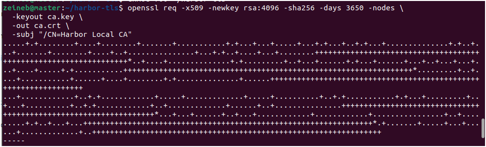

The files are:

- `ca.key`: the CA private key. Keep it secret.
- `ca.crt`: the public CA certificate. This can be distributed to clients that need to trust the Harbor certificate.

### 3.2 Generate the Harbor server key and certificate request

Create the server private key and certificate signing request (CSR):

```bash
openssl req -new -newkey rsa:3072 -nodes \
  -keyout harbor.key \
  -out harbor.csr \
  -subj "/CN=harbor.k8s.local"
```

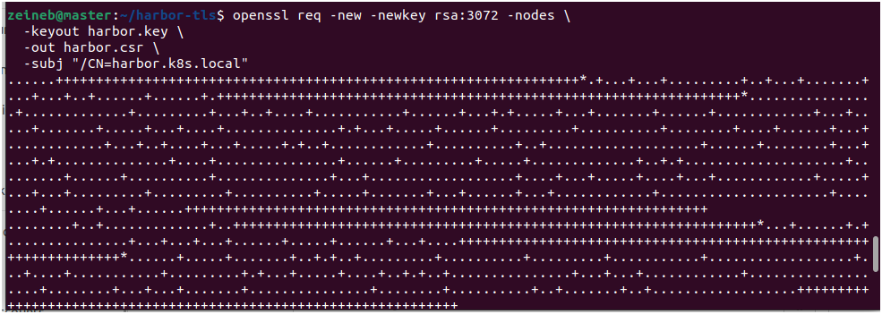

### 3.3 Configure the certificate extensions

Create an extensions file containing the DNS Subject Alternative Name (SAN):

```bash
cat > harbor.ext <<'EOF'
basicConstraints=critical,CA:FALSE
keyUsage=critical,digitalSignature,keyEncipherment
extendedKeyUsage=serverAuth
subjectAltName=DNS:harbor.k8s.local
EOF
```


The SAN is important because clients validate the hostname against the certificate.

### 3.4 Sign the Harbor certificate

Sign the server certificate with the local CA:

```bash
openssl x509 -req \
  -in harbor.csr \
  -CA ca.crt \
  -CAkey ca.key \
  -CAcreateserial \
  -out harbor.crt \
  -days 825 \
  -sha256 \
  -extfile harbor.ext
```

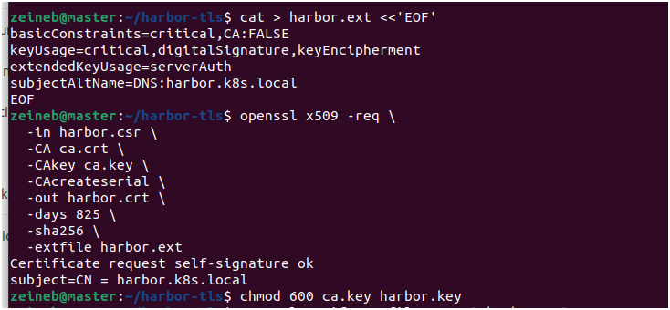

Restrict access to the private keys:

```bash
chmod 600 ca.key harbor.key
```

**Security warning:** Never upload `ca.key` or `harbor.key` to GitHub. The CA private key is especially sensitive because it can sign other certificates.

## 4. Validate the TLS Certificate

Verify the server certificate against the local CA:

```bash
openssl verify -CAfile ca.crt harbor.crt
```


Expected result:

```text
harbor.crt: OK
```

Inspect the certificate subject, issuer and validity dates:

```bash
openssl x509 -in harbor.crt -noout -subject -issuer -dates
```

Verify the Subject Alternative Name:

```bash
openssl x509 -in harbor.crt -noout -ext subjectAltName
```

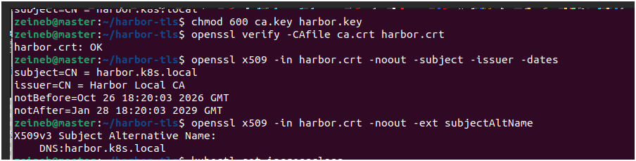

The output must contain:

```text
DNS:harbor.k8s.local
```

Check that the private key matches the certificate:

```bash
openssl x509 -in harbor.crt -pubkey -noout | openssl sha256
openssl pkey -in harbor.key -pubout | openssl sha256
```

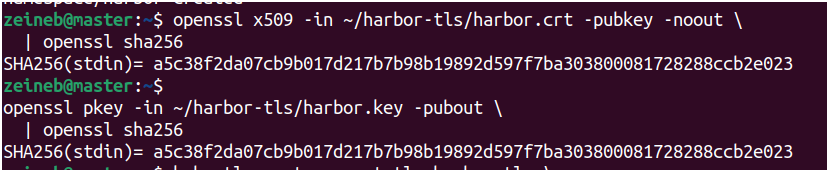

Both command outputs should contain the same hash.

## 5. Create the Harbor Namespace and Kubernetes Secrets

Create the namespace:

```bash
kubectl create namespace harbor
```

If the namespace already exists, verify it rather than deleting it.

Create the TLS Secret from the server certificate and private key:

```bash
kubectl create secret tls harbor-tls \
  --namespace harbor \
  --cert="$HOME/harbor-tls/harbor.crt" \
  --key="$HOME/harbor-tls/harbor.key"
```
Inspect the Secret:

```bash
kubectl describe secret harbor-tls -n harbor
```
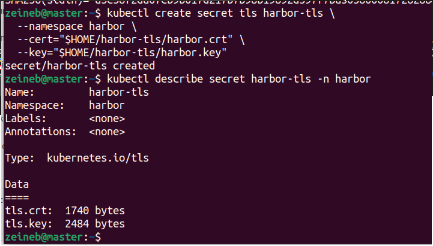

The Secret type should be `kubernetes.io/tls`, with the `tls.crt` and `tls.key` entries.

Create a Secret containing the public CA certificate. This allows Harbor's portal to offer the CA certificate for download when configured through the chart's `caSecretName` value:

```bash
kubectl create secret generic harbor-ca \
  --namespace harbor \
  --from-file=ca.crt="$HOME/harbor-tls/ca.crt"
```

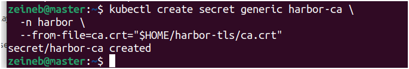

Verify the Secrets:

```bash
kubectl get secrets -n harbor
```

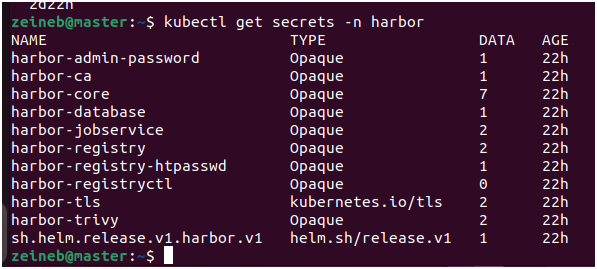

Expected Secret names include `harbor-tls` and `harbor-ca`.

## 6. Create the Harbor Administrator Password Secret

Prompt for a password without displaying it in the terminal:

```bash
read -rsp "Harbor administrator password: " HARBOR_ADMIN_PASSWORD
echo
```

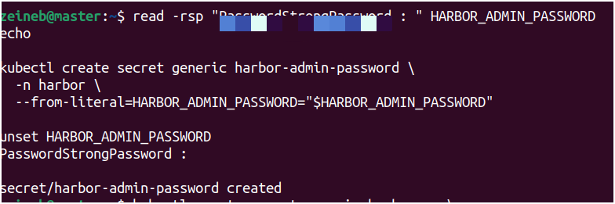

Create a Kubernetes Secret to store the password:

```bash
kubectl create secret generic harbor-admin-password \
  --namespace harbor \
  --from-literal=HARBOR_ADMIN_PASSWORD="$HARBOR_ADMIN_PASSWORD"
```

Remove the password variable from the current shell:

```bash
unset HARBOR_ADMIN_PASSWORD
```

The password is stored in a Kubernetes Secret rather than written directly into the Helm values file. Use a strong, unique password.

## 7. Add the Official Harbor Helm Repository

Add the official Harbor chart repository:

```bash
helm repo add harbor https://helm.goharbor.io
```
Update the Helm repository metadata:

```bash
helm repo update
```


Check the chart information:

```bash
helm show chart harbor/harbor
```

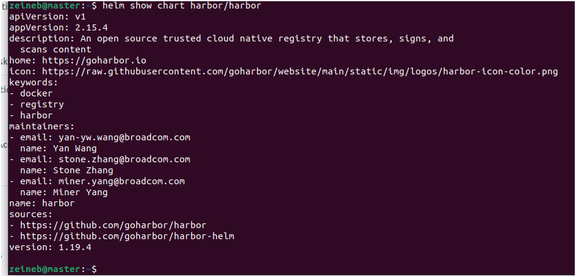

For reproducible deployments, note the chart version shown by this command and consider pinning that version during installation.

Inspect the chart's persistence configuration:

```bash
helm show values harbor/harbor | sed -n '/^persistence:/,/^imageChartStorage:/p'
```

The Harbor chart supports configuring persistent volumes through `persistence.persistentVolumeClaim`. This guide configures the registry, job logs, database, Redis and Trivy to use the existing `nfs-harbor` StorageClass.

## 8. Create the Harbor Helm Values File

Generate a random 16-character secret key and a random database password:

```bash
SECRET_KEY="$(openssl rand -hex 8)"
DB_PASSWORD="$(openssl rand -hex 16)"
```
Create the Helm values file:

```bash
cat > "$HOME/harbor-values.yaml" <<EOF
expose:
  type: ingress
  tls:
    enabled: true
    certSource: secret
    secret:
      secretName: harbor-tls
  ingress:
    className: traefik
    hosts:
      core: harbor.k8s.local
    annotations:
      traefik.ingress.kubernetes.io/router.entrypoints: websecure
      traefik.ingress.kubernetes.io/router.tls: "true"

externalURL: https://harbor.k8s.local

existingSecretAdminPassword: harbor-admin-password
existingSecretAdminPasswordKey: HARBOR_ADMIN_PASSWORD

caSecretName: harbor-ca

secretKey: "\${SECRET_KEY}"

persistence:
  enabled: true
  resourcePolicy: keep
  persistentVolumeClaim:
    registry:
      storageClass: nfs-harbor
      accessMode: ReadWriteOnce
      size: 20Gi
    jobservice:
      jobLog:
        storageClass: nfs-harbor
        accessMode: ReadWriteOnce
        size: 1Gi
    database:
      storageClass: nfs-harbor
      accessMode: ReadWriteOnce
      size: 5Gi
    redis:
      storageClass: nfs-harbor
      accessMode: ReadWriteOnce
      size: 1Gi
    trivy:
      storageClass: nfs-harbor
      accessMode: ReadWriteOnce
      size: 5Gi

database:
  type: internal
  internal:
    password: "\${DB_PASSWORD}"
EOF
```


Protect the values file because it contains the database password and secret key:

```bash
chmod 600 "$HOME/harbor-values.yaml"
```


Clear the shell variables:

```bash
unset SECRET_KEY DB_PASSWORD
```


**Important configuration notes:**

- The `traefik` IngressClass name must match the name returned by `kubectl get ingressclass`.
- The `websecure` entrypoint must exist in the Traefik configuration.
- The TLS certificate must be valid for `harbor.k8s.local`.
- The `nfs-harbor` StorageClass must be able to provision the requested volumes.
- The example storage sizes are lab values. Adjust them to match available NFS capacity.
- The values above configure TLS for client connections through the Ingress. Harbor internal component TLS is a separate setting and is not enabled by this configuration.

## 9. Validate the Helm Configuration Before Installation

Check the StorageClass again:

```bash
kubectl get storageclass nfs-harbor
```

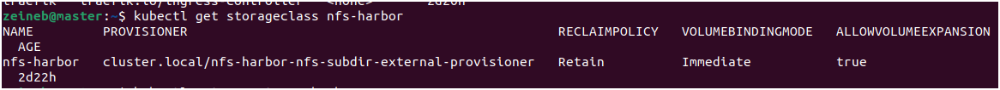

Render the Harbor Kubernetes manifests without installing them:

```bash
helm template harbor harbor/harbor \
  --namespace harbor \
  --values "$HOME/harbor-values.yaml" \
  > /tmp/harbor-rendered.yaml
```

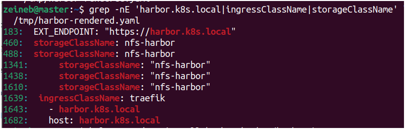

If the command fails, correct the values file before proceeding.

Inspect the generated manifests for the hostname, IngressClass and storage class:

```bash
grep -nE 'harbor.k8s.local|ingressClassName|storageClassName' \
  /tmp/harbor-rendered.yaml
```


Check that the generated configuration contains the expected hostname and `nfs-harbor` storage references.

## 10. Install Harbor with Helm

Install Harbor only after the validation steps succeed:

```bash
helm upgrade --install harbor harbor/harbor \
  --namespace harbor \
  --values "$HOME/harbor-values.yaml" \
  --wait \
  --timeout 20m
```

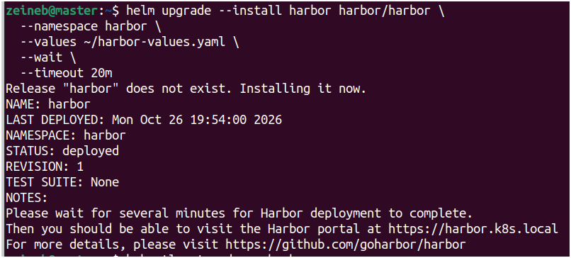

This command installs Harbor or upgrades the existing Helm release named `harbor`. The `--wait` option waits for Kubernetes resources to become ready, up to the specified timeout.

## 11. Verify the Harbor Deployment

Check the Pods:

```bash
kubectl get pods -n harbor
```

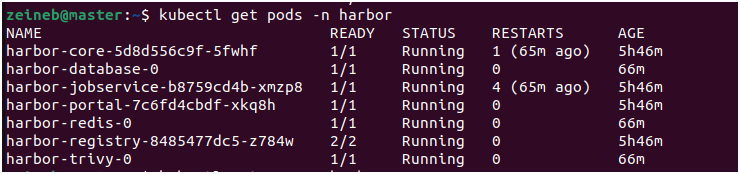

Check the Services:

```bash
kubectl get svc -n harbor
```

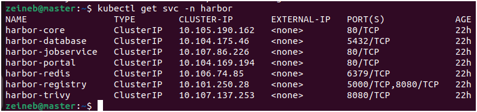

Check the PersistentVolumeClaims:

```bash
kubectl get pvc -n harbor
```

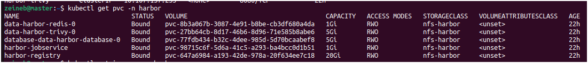

The PVCs should eventually show `Bound`. If they remain `Pending`, inspect the StorageClass, NFS provisioner and PVC events before continuing.

Check the Ingress:

```bash
kubectl get ingress -n harbor
```

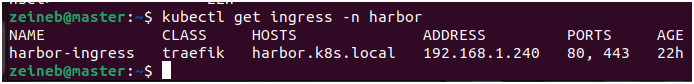

Check the Helm release:

```bash
helm status harbor -n harbor
```

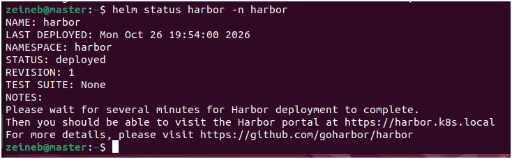

## 12. Troubleshoot Pods and Storage

If any Pod is not ready, inspect the namespace events:

```bash
kubectl get events -n harbor --sort-by=.metadata.creationTimestamp
```


Inspect a problematic Pod:

```bash
kubectl describe pod -n harbor <POD_NAME>
```


Replace `<POD_NAME>` with the actual Pod name from `kubectl get pods -n harbor`.

Check the logs of a problematic component:

```bash
kubectl logs -n harbor <POD_NAME> --all-containers=true --tail=100
```


Replace `<POD_NAME>` with the actual Pod name. Use the events, Pod description and logs to identify whether the issue is related to image pulls, storage, permissions, configuration or application startup.

## 13. Trust the Local CA on Client Machines

The certificate is signed by a local CA, so client machines must trust `ca.crt` to validate the server certificate without warnings.

### Linux clients

Securely transfer **only** `ca.crt` to the Linux client. Do not transfer `ca.key` or the server's private key.

On Debian/Ubuntu clients, copy the CA certificate to the local trust store:

```bash
sudo cp ca.crt /usr/local/share/ca-certificates/harbor-local-ca.crt
```


Update the CA certificates:

```bash
sudo update-ca-certificates
```


### Windows clients

Transfer `ca.crt` securely to the Windows client. Open PowerShell as Administrator and import the CA into the local machine's Trusted Root Certification Authorities store:

```powershell
Import-Certificate -FilePath "C:\path\to\ca.crt" -CertStoreLocation Cert:\LocalMachine\Root
```


Replace `C:\path\to\ca.crt` with the actual file path. Only import a CA certificate that you generated and control.

## 14. Test Harbor HTTPS Access

From a client that resolves `harbor.k8s.local` to the Traefik external IP, run:

```bash
curl --cacert "$HOME/harbor-tls/ca.crt" -I https://harbor.k8s.local
```


On a client where the CA has been installed in the operating system trust store, you can test with:

```bash
curl -I https://harbor.k8s.local
```

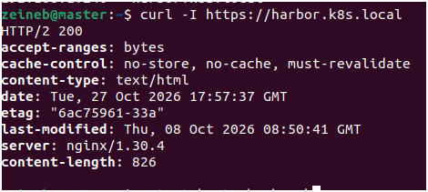

The exact HTTP status depends on the Harbor configuration. A successful TLS connection should not report a certificate trust or hostname mismatch error.

Open the following URL in a browser:

`https://harbor.k8s.local`

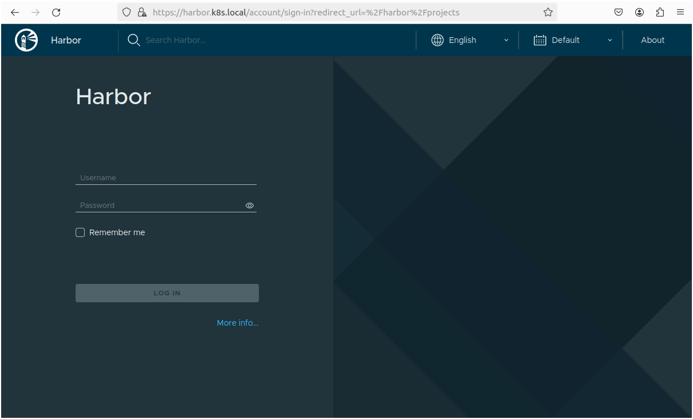

Sign in using the username `admin` and the administrator password configured earlier.

**Security note:** Do not use `curl -k` as a permanent solution to certificate errors. Verify the DNS record, certificate SAN, certificate chain and client CA trust instead.

## 15. Verify the NFS Storage

Check the PersistentVolumeClaims:

```bash
kubectl get pvc -n harbor
```


Check the PersistentVolumes:

```bash
kubectl get pv
```


Check the NFS server to confirm that the provisioned Harbor data directories exist in the configured NFS export. The exact paths depend on your NFS provisioner and StorageClass configuration.

Do not manually delete Harbor data directories or PVCs during troubleshooting.


- `ca.key`
- `harbor.key`
- `harbor.csr`
- `harbor.crt` if you prefer to keep generated deployment material outside the repository
- `ca.crt` if you do not want to distribute your local CA certificate through the repository
- `harbor-values.yaml`, because it contains the database password and secret key


## References

- [Official Harbor Helm Chart](https://github.com/goharbor/harbor-helm)
- [Harbor Helm Chart Values](https://github.com/goharbor/harbor-helm/blob/main/values.yaml)
- [Kubernetes Ingress Documentation](https://kubernetes.io/docs/concepts/services-networking/ingress/)
- [Kubernetes TLS Secrets](https://kubernetes.io/docs/concepts/configuration/secret/)
- [OpenSSL Documentation](https://docs.openssl.org/)
- [Traefik Kubernetes Ingress Provider](https://doc.traefik.io/traefik/providers/kubernetes-ingress/)
